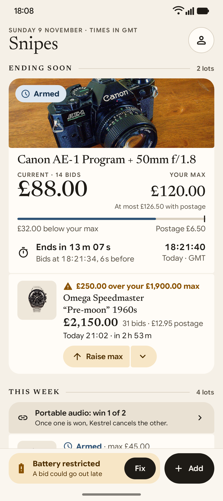
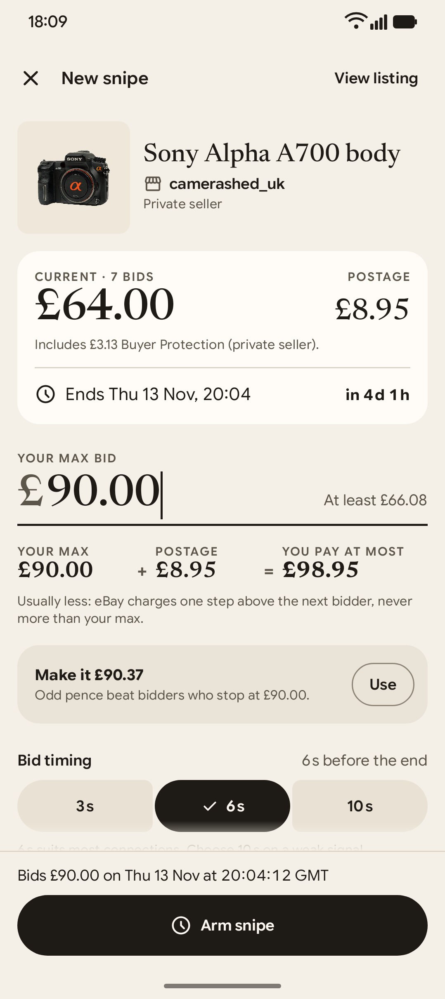
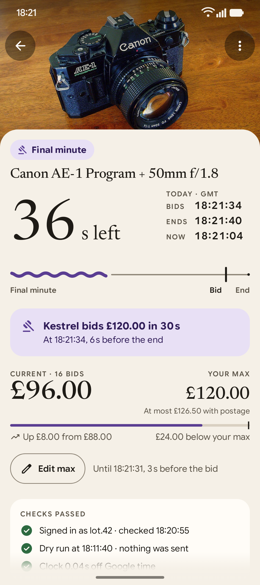
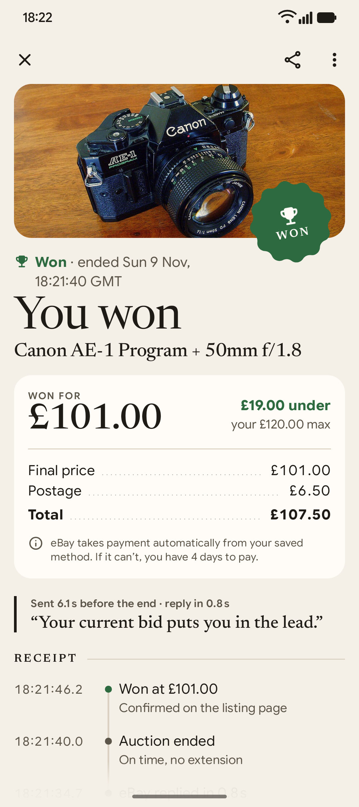
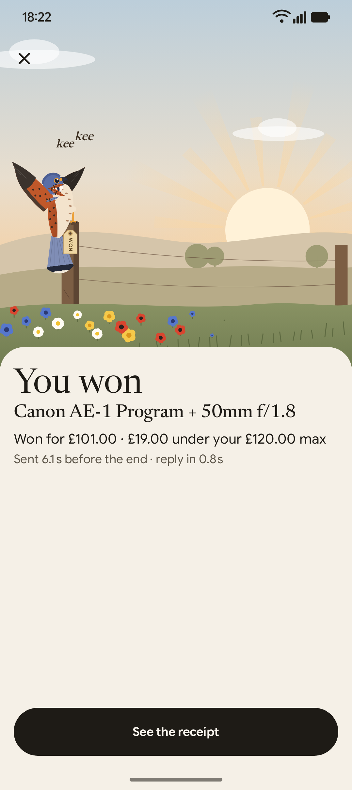

# Kestrel

Kestrel is an Android app that snipes eBay auctions. It bids your maximum a few seconds before the end, from your own
phone, through your own signed-in eBay session. There is no server, no account to create, no ads and no fees.

<p align="center">
  
  
  
  
  
</p>

## How it works

1. Share a listing from the eBay app (or paste its link), set your maximum and tap **Arm snipe**.
2. About 10 minutes before the end, Kestrel does a **dry run**. It opens eBay's bid panel, types your maximum and
   stops without bidding. Sign-in, captcha or phone-verification problems show up while you can still fix them.
3. A few seconds before the end (6 s by default, 3 to 10 s if you prefer), it submits your maximum once. eBay's proxy
   bidding means you pay one step above the next bidder, never more than your maximum.
4. It follows the auction to its real end, including eBay's **Extended bidding** (a late bid resets the clock to
   60 s), then tells you **Won** or **Lost** with eBay's own words and a timeline of what happened.
5. If the price passes your maximum before the end, a notification offers **Raise max**.

You can also put snipes in a group ("win 1 of 2") so that Kestrel stops bidding on the others once one is won.

## What Kestrel will never do

- Bid above your maximum, change it by itself, buy anything or pay for anything.
- Press eBay's bid button more than once per snipe.
- Submit anything during a dry run.
- Solve a captcha or a verification step. It stops, notifies you and opens eBay's page for you.
- Send your session or your data anywhere. Apart from eBay's own pages, the only call it makes is to time.google.com,
  to check the clock.
- Check listings more often than a person would: every 6 hours when the end is days away, down to every 15 minutes
  in the last hour.

## Install

Kestrel needs Android 16 or later. It is built and tested on a Pixel 9a with Android 17.

1. Download `Kestrel-<version>.apk` from [Releases](../../releases).
2. Optionally check it. The SHA-256 is in the release notes, and every release is signed with the same certificate:

   ```bash
   sha256sum Kestrel-<version>.apk
   apksigner verify --print-certs Kestrel-<version>.apk
   # certificate SHA-256 digest: 368d478120d8e5e10df3a81a6a2db57d6ddefc4a7b010c638772b223cf998015
   ```

3. Open the APK on the phone (or run `adb install -r Kestrel-<version>.apk`) and allow installs from that source when
   Android asks. Updates install over the previous version and keep your snipes.

## First run

1. **Sign in to eBay** on eBay's own page inside the app, with your email or username and your eBay password.
   Two-step codes (SMS or an authenticator app) work. "Continue with Google", Facebook or Apple do not, because those
   providers block embedded browsers. If you normally use one of them, set an eBay password first.
2. **Allow notifications.** This is how you hear "Won", "Lost" and "Price passed your max".
3. On **Ready to snipe**, fix anything that is not green. Set Battery to **Unrestricted**: it keeps the bid on time
   while the phone sleeps. Live Updates are optional; they show a countdown in the status bar in the final minutes.

Start with a cheap auction that ends within a day or two. When its dry run passes, sign-in, the bid panel and typing
the amount all work on your account. If it fails, the snipe's timeline says why.

## Limits

- The phone does the bidding. It must be on, online and charged at the end time. Ready to snipe and the
  notifications tell you when something is at risk.
- eBay changes its pages from time to time. The daily and pre-end dry runs catch that before an auction is lost.
- Extended bidding gives other bidders a chance to answer a late bid. Kestrel keeps following the auction to the end.
- Kestrel signs in on ebay.co.uk and opens every listing there, whichever eBay site the link comes from. eBay item
  numbers are global, so the snipe works, and the max and the bid are in the listing's currency. A seller who does not
  post to the UK can block the bid; the dry run shows it.

## Build from source

You need JDK 21, the Android SDK (platform android-37.2 and build-tools 37.0.0) and, for the page-helper tests,
Node.js 22.13 or later. The build and the tests run on Linux.

```bash
./gradlew assembleDebug                    # app/build/outputs/apk/debug/app-debug.apk
./gradlew testDebugUnitTest                # JVM tests: parsing, engine, platform and UI screenshots
(cd tools/jstest && npm ci && npm test)    # tests of the page helper against archived eBay pages
```

`./gradlew assembleRelease` signs the APK only when `../kestrel-signing/signing.properties` exists next to the
repository, with `storeFile`, `storePassword`, `keyAlias` and `keyPassword`. Without it the release APK is unsigned.

## Project layout

```
app/src/main/kotlin/app/kestrel/
  model/      the domain: money, listings, snipes, groups, timeline events
  ebay/       reading eBay: links, page models, listings, bid increments, page types
  engine/     one snipe window: dry run, the bid, following the end, the result
  web/        the WebView side and the page helper's Kotlin API
  platform/   Android: alarms, the foreground service, WorkManager, notifications, readiness
  data/       Room database and settings
  ui/         Jetpack Compose screens
app/src/main/assets/js/kestrel.js   the page helper that reads and drives eBay's page
tools/jstest/                       jsdom tests of the page helper
tools/sound/                        scripts that synthesise the win sounds
docs/                               architecture, design and research
```

- [docs/ARCHITECTURE.md](docs/ARCHITECTURE.md): how a snipe runs and the safety rules behind it.
- [docs/DESIGN.md](docs/DESIGN.md): the design system and every screen.
- [docs/research/](docs/research/): eBay's bid flow, Android timing, eBay's rules and other snipers.

## Contributing

See [CONTRIBUTING.md](CONTRIBUTING.md).

## eBay's rules

Kestrel is not affiliated with, endorsed by or sponsored by eBay. eBay's help pages say that bid sniping, "including
the use of software that places bids for you", is allowed. eBay's User Agreement also forbids automated access
without its permission. Kestrel keeps you in charge of every bid: you choose each listing and confirm each maximum,
and it never bids, raises or buys on its own. You are responsible for your bids and for how you use the app.

## Support

Kestrel has no ads and no fees. If it wins you something you wanted, you can
[buy me a coffee](https://ko-fi.com/ivallesp).

## Credits

- Fonts: Google Sans Flex and Newsreader, both under the SIL Open Font Licence (`app/src/main/assets/licenses/`).
- Product photos in the screenshots: Wikimedia Commons, credited in `app/src/test/resources/photos/CREDITS.txt`.
